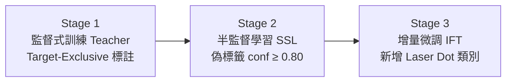

# AI 果園防猴系統

**演講者**：大同大學資工系 卓世朋主任
**日期**：2026/10/13

---

## 目錄

- [一、演講筆記](#一演講筆記)
- [二、簡介](#二簡介)
- [三、相關技術說明](#三相關技術說明)
  - [1. 感知層（Perception）：偵測與追蹤](#1-感知層perception偵測與追蹤)
  - [2. 決策層（Decision）：DDPG 強化學習](#2-決策層decisionddpg-強化學習)
  - [3. 執行層（Action）：雷射校正與控制](#3-執行層action雷射校正與控制)
  - [4. 邊緣部署與雲邊協同](#4-邊緣部署與雲邊協同)
- [四、心得報告](#四心得報告)
- [五、關鍵字](#五關鍵字)
- [六、參考文獻](#六參考文獻)

---

## 一、演講筆記

- 共三篇論文：
  1. AI 即時影像辨識結合雷射驅離果園防猴系統
  2. 結合多目標追蹤與強化學習的抗習慣化雷射驅離系統
  3. 撰寫中
- 猴子是成群結隊的，並且裡面可能有智猴，有機會由羊群效應主導
- 曾發生過猴子觸碰到電網後就繞過的案例
- 直接對果樹造成的損害大約 > 15%
- 台灣獼猴學習速度很快

### 第一代論文

- 使用影像辨識加上雷射槍，高功率的雷射筆可能會讓猴子的皮膚受傷
- 流程：**感知**（影像串流）→ **決策**（YOLOv5）→ **轉接**（校正函數：像素座標與雷射角度的對應）→ **MQTT** 下指令
- 影像辨識的訓練資料是用猴子玩偶拍攝，共 6,000 張影像
- 問題：夜間偵測 mAP 降低、人臉誤判、多目標、成效如何定義

### 第二代論文

- 改用真猴資料，並處理多目標與抗習慣化
- 模型改用 YOLOv12、BoT-SORT 多目標追蹤、DDPG 自適應策略（避免固定的驅離模式）、像素誤差調整、Edge AI 推論
- 訓練流程：監督式訓練 → 半監督學習 → 增量微調
- 強化學習：把「不可預測性」寫進獎勵函數

### 第三代論文（撰寫中）

- 處理影像辨識的假警報問題
- RGB 與熱成像互補
- 雙鏡頭融合偵測
- 無人機搭配高分貝聲響驅離

---

## 二、簡介

長年來果農飽受動物侵擾，許多果樹都會受到台灣獼猴的破壞。為了防治，講者團隊發表了兩篇論文，目前正在撰寫第三篇：

1. **第一篇**：利用影像辨識加上雷射筆驅離。但模型成功率不高，多目標情況下準確度也偏低。
2. **第二篇**：提升了模型成功率，不過仍受光線影響。新增了強化學習等演算法來控制雷射驅離，但猴子仍可能逐漸習慣。
3. **第三篇**：結合影像辨識、多模態感測與無人機驅逐，達到有效驅離，保護果樹與收成。

---

## 三、相關技術說明

### 1. 感知層（Perception）：偵測與追蹤

#### 1.1 物件偵測：YOLOv12n

- 以 Ultralytics YOLOv12n 預訓練權重為起點做微調，內建注意力機制，對小目標和複雜背景比較有利。
- 比較對象：YOLOv8n / YOLOv10n / YOLOv11n。
- 偵測類別：`Macaque`、`Laser Dot`。

#### 1.2 三階段訓練框架（SSL + IFT）



| 階段 | 技術 | 重點 |
|---|---|---|
| **S1** | Target-Exclusive 標註 / Implicit Background | 只標獼猴，人、貓、狗不標，當作隱性背景；另加入約 10% 純背景圖。Precision 達 0.924 |
| **S2** | Semi-Supervised Learning（Teacher–Student） | Teacher 替 536 張未標註圖片產生偽標籤，只保留 conf ≥ 0.80 的。YOLOv12n 的保留率為 47.1%，人工檢查錯誤率為 0% |
| **S3** | Incremental Fine-Tuning | 避免災難性遺忘（Catastrophic Forgetting），超參數見下 |

S3 的 IFT 超參數：

```yaml
freeze: 10          # 凍結前 10 層 backbone
lr0: 0.0002         # 或 0.0005，極低學習率，作用類似 L2 正則化
epochs: 40          # 或 75，縮短訓練
```

整體效益：**人工標註減少約 60%，訓練時間減少約 68%**。

#### 1.3 多目標追蹤（MOT）

| 演算法 | 核心原理 | 優點 | 缺點 |
|---|---|---|---|
| DeepSORT | 運動 + 外觀（Re-ID） | 可長時間追蹤 | 需要自訂 Re-ID，成本高 |
| ByteTrack | 也關聯低分偵測框 | 極快，擅長處理短暫遮擋 | 不用外觀特徵，ID 容易斷 |
| OC-SORT | 改良的運動模型 | 適合非線性運動 | 不用外觀特徵 |
| **BoT-SORT** | 運動 + 外觀 + 相機運動補償（CMC） | ID 最穩定 | Re-ID 運算成本高 |

> [!NOTE]
> 獼猴彼此長得很像（類內相似度高），BoT-SORT 的 Re-ID 特徵能大幅減少 ID Switch。

#### 1.4 多感測器融合

- **RGB + 近紅外（NIR）+ ToF 深度相機**
- 影像增強：自動曝光補償、去霧（Dehazing）
- 目標是全天候偵測（低光、逆光、雨、霧）

---

### 2. 決策層（Decision）：DDPG 強化學習

採用 **Deep Deterministic Policy Gradient（DDPG）**，並結合貝氏決策理論組成混合框架。

| 元素 | 定義 |
|---|---|
| **狀態空間（State）** | 目標的即時軌跡與速度、離果園邊界的距離、猴群密度 |
| **動作空間（Action，連續）** | 雷射的水平與垂直角度、功率調變、驅趕模式（定點 / 隨機掃描 / 閃爍頻率） |

**複合獎勵函數**：

$$
R = w_{deter} \cdot R_{deter} + w_{safety} \cdot R_{safety} - w_{habituation} \cdot R_{habituation}
$$

| 分量 | 意義 | 權重 |
|---|---|---|
| $R_{deter}$ | 驅趕成功（離開 ROI、停留時間縮短） | 1.0 |
| $R_{safety}$ | 安全與節能（< 5 mW、間歇式驅趕） | 0.5 |
| $R_{habituation}$ | 習慣化懲罰，依**動作序列 entropy** 計算，重複固定模式就扣分 | 0.8 |

> [!NOTE]
> 所有分量都先正規化到 [0, 1] 或 [-1, 1] 再加權。權重透過 Grid Search / Ablation Study 決定。

**理論背景**：Green Security Games（GSG）、追逃賽局（Pursuit-Evasion Game）。論文把習慣化看成對手在利用防守方的固定策略，所以需要隨機、非穩態的策略來因應。

> [!TIP]
> BoT-SORT 的軌跡穩定，是 DDPG 能正確計算速度、停留時間等歷史狀態的前提。

---

### 3. 執行層（Action）：雷射校正與控制

#### 3.1 二次多項式校正模型

$$
y_i = \beta_0 + \beta_1 x_i + \beta_2 x_i^2 + \varepsilon_i
$$

- $x_i$：雷射光點在影像中的水平像素座標
- $y_i$：雲台的實際水平角度
- $x^2$ 項用來補償**鏡頭畸變、機構安裝誤差、馬達非線性**

#### 3.2 參數估計：最小平方法（OLS）

$$
SSR = \sum_{i=1}^{N}\left(y_i - (\hat\beta_0 + \hat\beta_1 x_i + \hat\beta_2 x_i^2)\right)^2,\quad
\frac{\partial SSR}{\partial \beta_j} = 0
$$

依 Gauss-Markov 定理，OLS 估計量是最佳線性不偏估計量（BLUE）。

實際瞄準時：

$$
\hat y_{aim} = \hat\beta_0 + \hat\beta_1 x_{target} + \hat\beta_2 x_{target}^2
$$

#### 3.3 校正結果

- 估計係數：$\hat\beta_0 = 98.527$、$\hat\beta_1 = -0.05074$、$\hat\beta_2 = 0.000012$
- N = 181 個**均勻分布**的校正點時，**RMSE = 1.2 px**
- 如果校正點集中在畫面中央，影像邊緣的 RMSE 會惡化到 4–5 px

#### 3.4 安全規範

- **Class 2 雷射**（≤ 5 mW），符合 **IEC 60825-1**
- 設有安全區和自動關機機制

---

### 4. 邊緣部署與雲邊協同

| 項目 | 技術 / 數值 |
|---|---|
| 邊緣運算 | NVIDIA Jetson（AGX Orin / Xavier NX） |
| 推論加速 | **TensorRT FP16** |
| 最高速度 | 480 FPS（640×640，AGX Orin） |
| 平均速度 | 35.0 FPS |
| 平均延遲 | 28.6 ms |
| GPU 使用率 | 42% |
| 系統功耗 | 12.5 W（2.8 FPS/W） |
| ROI Mask | 運算量減少 18% |
| Temporal Event Filter | 連續 3 幀 conf ≥ 0.8 才觸發警報 |
| 通訊 | Wi-Fi 6、5G/LTE |
| 雲端 | Azure / AWS（資料儲存、模型重新訓練、Web HMI） |
| 人機協作 | Human-in-the-loop HMI，可人工調整策略 |

---

## 四、心得報告

果園除了蟲害，還需要防範動物。本次演講的教授從最初的系統一路講到最新的系統，說明它如何逐步演變與改善，幫助果農減少猴子的侵害。

最新的論文仍在撰寫中，內容提到**雙鏡頭熱影像融合**加上**無人機空中驅離**：在茂密的森林裡用熱成像掃描猴子等動物的蹤跡，再由無人機發出高分貝聲響，或可能噴灑辣椒水，達到人道且兼顧環境衛生安全的驅離。對果農來說是極大的幫助！

---

## 五、關鍵字

`多模態` · `台灣獼猴` · `監督式學習` · `半監督式學習` · `強化學習` · `無人機` · `RGB` · `熱成像` · `區域協同網路` · `YOLO`

---

## 六、參考文獻

1. Cho, S.-M., Wang, S.-W., Chiu, M.-C., & Chen, S.-C. (2026). An Intelligent Orchard Anti-Damage System Combining Real-Time AI Image Recognition and Laser-Based Deterrence for Multi-Target Monkeys. *Computers, Materials & Continua*, *87*(2), 37. https://doi.org/10.32604/cmc.2025.074911 （SCIE）
2. 另有一篇較早期的論文（第一代系統）在課堂上有提到，目前尚未找到出處（待補）。
